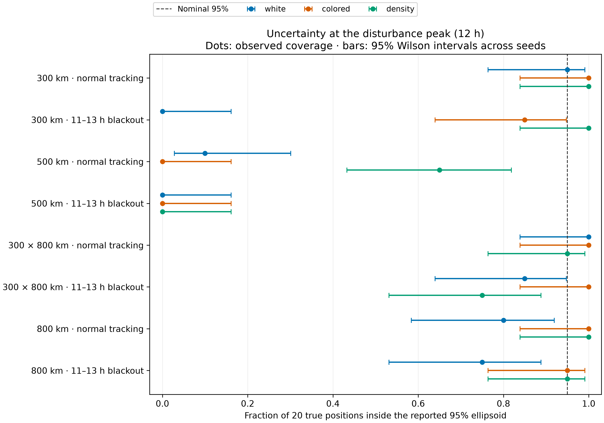

# Orbital smoothing proof of concept

Reconstruct a past satellite trajectory from simulated ground-station range and
range-rate. Compare white acceleration noise, a correlated acceleration model,
and a time-varying atmospheric density correction. GTSAM and an independent
iterated Kalman/RTS smoother solve the same approximate posterior. NumPyro is a
bounded short-arc diagnostic, accepted as a reference only when its diagnostics
pass.

This is a research benchmark of ideal geometric observations, not an operational
orbit-determination or collision-avoidance system. See the generated HTML report
and run manifests for what was actually run; a supported configuration is not
evidence that its experiment completed.

## Completed v2 campaign

Open [results.html](results.html) for the scientific summary and
[the full diagnostic report](runs/v2/combined/report/report.html) for every fit.
The 20-seed campaign completed 1,280 primary fits and all 96 required GTSAM/IEKS
equivalence checks. This numerical success does **not** validate uncertainty:
at the disturbance peak during the 500 km tracking blackout, the nominal 95%
position ellipsoids covered 0/20 true positions for every stochastic model.
Density information at 800 km remained weak despite accurate trajectories.

Independent v2 calibration attempted 740 fits after broader acceleration grids
corrected an unfair upper-boundary truncation. Four candidate fits did not
qualify; all selected candidates had five valid calibration seeds. The selected
grids passed their boundary checks before the final evaluation. The separate
realistic-force stress case failed to transfer this controlled calibration
reliably; its density fit did not converge. NumPyro posterior checks are tracked
separately in the results page and must pass their own diagnostics.

The five bounded NumPyro checks all reached their 30-minute limits before
completing sampling. They provide no accepted posterior reference or available
R-hat/ESS diagnostics. This is a computationally inconclusive result, not proof
that the Gaussian approximation is correct or incorrect. All jobs have stopped.
See the [posterior audit](validation/posterior_completion.json) and
[final acceptance summary](validation/acceptance_summary.json). The scientific
source passed 49 tests, and all six walkthrough code cells executed successfully.

## Repository contents

This public repository contains the complete implementation, configuration,
notebooks, plots, aggregate CSVs, and compact campaign records. The approximately
1.3 GB of raw runs, trajectory arrays, third-party weather archives, environments,
and machine-control logs are excluded. Run the reproduction commands to generate
those artifacts locally. Saved manifests may refer to raw artifacts that are
not bundled; the included HTML reports are static snapshots and can be opened
locally after cloning. Regenerating them requires the corresponding raw runs.

Published result metadata generalizes absolute paths and machine names. The
scientific source files and recorded numerical results are unchanged. See
[PUBLICATION.json](PUBLICATION.json) for the export scope. The reported 49-test
campaign included an optional historical regression dataset; a fresh checkout
skips that one test unless `ORBIT_POC_REGRESSION_DATA_ROOT` is supplied.



## Install

Python 3.11 is the validated interpreter. Use a dedicated environment. The NumPy
1.x pin is deliberate for the GTSAM 4.2 binary package.

```bash
python3.11 -m venv .venv
.venv/bin/python -m pip install -r requirements-cpu.lock.txt
.venv/bin/python -m pip install --no-deps -e .
bash scripts/runtime.sh .venv/bin/python -m pytest -q
```

For the NVIDIA GPU environment, use `requirements-gpu.lock.txt` instead. It
includes CUDA runtime wheels; no system driver is changed. Choose an available
GPU using `CUDA_VISIBLE_DEVICES` and set `JAX_PLATFORMS=cuda` when invoking the
runtime wrapper. Factor graph solves themselves run on CPUs.

TudatPy has a separate Conda environment. The exact Linux package URLs are saved
in `tudat-linux-64.lock.txt`. A fresh install can use:

```bash
micromamba create -y -p ./tudat-env -f tudat-linux-64.lock.txt
```

Alternatively install `tudatpy=1.0.0` from `tudat-team` and `conda-forge`, then
record the resolved versions. Pass that environment's Python executable to
`--tudat-python`. The simulator is an independent subprocess and does not import
the inference dynamics. Tudat requires its installed resource bundle. The stress
generator copies its selected space-weather archive and records a SHA256 hash.

## Commands

```bash
orbit-poc --help
orbit-poc generate --help
orbit-poc calibrate --help
orbit-poc fit --help
orbit-poc benchmark --help
orbit-poc report --help
```

Use `bash scripts/runtime.sh ...` for CPU jobs to constrain BLAS threading and
disable GPU memory preallocation. Command help is authoritative for options.
`configs/scenarios.json` specifies the scientific experiment. The walkthrough
notebook shows data loading, fitting, and plotting. Results and checkpoints live
under the output directory selected on the command line.

To reproduce the calibrated 20-seed matrix on one host, after installation and
the numerical validation tests:

```bash
export TUDAT_PYTHON="/absolute/path/to/tudat-env/bin/python"
bash scripts/runtime.sh .venv/bin/python -m orbit_poc.cli calibrate \
  --config configs/scenarios.json --output-dir runs/reproduction/calibration \
  --max-iterations 60 --tudat-python "$TUDAT_PYTHON"
bash scripts/runtime.sh .venv/bin/python -m orbit_poc.cli benchmark \
  --config configs/scenarios.json --output-dir runs/reproduction/benchmark \
  --calibration runs/reproduction/calibration/calibration.json \
  --seeds 20 --workers 8 --budget-hours 6 --max-iterations 60 \
  --tudat-python "$TUDAT_PYTHON"
.venv/bin/python -m orbit_poc.cli report --input-dir runs/reproduction/benchmark
```

The saved campaign split the two low circular orbits and the two remaining
orbits across separate hosts. Independent per-orbit calibration manifests can
be joined with `merge-calibration`; disjoint evaluation manifests can be joined
with `merge-benchmark`. Both merge commands reject incompatible provenance.
Worker processes constrain CPU affinity and BLAS threading. Budgets stop new
jobs from starting; an already-running fit is checkpointed when it finishes.

The separate realism stress case can be reproduced without mixing it into the
controlled matrix:

```bash
bash scripts/runtime.sh .venv/bin/python analysis/run_stress_campaign.py \
  --calibration runs/v2/calibration/calibration.json \
  --output-dir runs/stress-reproduction --tudat-python "$TUDAT_PYTHON"
```

After generating the combined report, `analysis/derive_artifacts.py
runs/v2/combined` exports measurement residual arrays and the four example
trajectory figures. `analysis/coverage_snapshot.py runs/v2/combined` exports
the fixed-epoch coverage figure. Run both with the inference environment's
Python from the project root. These programs only derive outputs from saved
fits; they do not change the estimates.
For a fresh reproduction, replace `runs/v2/combined` in those commands with
`runs/reproduction/benchmark`, where the raw fits have just been generated.

Fresh-process memory profiles in
[validation/resource_usage/summary.json](validation/resource_usage/summary.json)
record 273.0, 278.3, and 286.2 MiB peak RSS for 6-, 12-, and 24-hour fits. They
include Python/JAX overhead and are single measurements on one host.

Truth and tracking inputs are separate files. `dataset.npz` holds only times,
observations, station states, measurement standard deviations, and the initial
prior. `truth.npz` is opened by evaluation code after inference. Each fit saves
SI states, marginal covariance blocks, configuration, objective, convergence
status, and provenance. No dense full-trajectory covariance is required.

## Experiment

| Item | Definition |
|---|---|
| Orbits | 300, 500, 800 km circular; 300 × 800 km eccentric; inclination 53° |
| Duration | 24 h evaluation; 6 h calibration; 2 h Bayesian checks |
| Spacecraft | 100 kg, area 1 m², drag coefficient 2.2, fixed attitude |
| Stations | Latitudes +45° at longitudes 0°, 120°, −120°; −35° at 60°, 180°, −60° |
| Tracking | Every 60 s above 10° elevation; range σ=10 m, range-rate σ=0.01 m/s |
| Prior | Cartesian position σ=1 km, velocity σ=1 m/s |
| Coverage | Natural visibility; same observations with hours 11–13 removed |
| Quiet truth | Seeded smooth multiscale log-density variation |
| Disturbed truth | Quiet variation plus a Gaussian log-density pulse, ×2 at 12 h, width 1 h |
| Controlled physics | Central gravity, J2, co-rotating atmosphere, analytic exponential density |
| Stress physics | Tudat Earth SH4×4, Sun/Moon gravity, SRP, NRLMSISE-00 and archived space weather |

The analytic density at 500 km is 5×10⁻¹³ kg/m³ with scale height 60 km. This is
an explicitly synthetic test atmosphere. The disturbance is not sampled from
the estimator's OU prior. Short Bayesian disturbance experiments explicitly
move the pulse into the short arc and record that configuration.

The stress cases deliberately change several force models and the atmosphere at
once; they measure robustness to model mismatch, not isolated atmosphere-model
accuracy. All stations use the declared synthetic rotating-Earth frame; tracking
omits light-time, clock errors, refraction, and operational Doppler processing.

## Statistical and numerical model

All methods share JAX float64 propagation and measurement derivatives. A state
node exists every 60 s, including during gaps. Internal units are 10⁶ m, 10³ m/s,
10⁻⁶ m/s² for empirical acceleration, and unitless log density.

* `white`: Cartesian position and velocity with white acceleration diffusion.
* `colored`: adds three RTN empirical accelerations, each with OU decay time τ
  and stationary standard deviation σₐ. The RTN basis follows the instantaneous
  state; derivatives include its dependence on that state.
* `density`: adds scalar b with density ρ=ρ₀ exp(b), and
  db=−b/τ dt + √(2σᵦ²/τ) dW.

Augmented models retain a common white-acceleration floor of 10⁻¹⁴ m²/s³. RK4
integrates each transition with a maximum nominal substep of 2.5 s. The initial
5 s setting failed the strict visible range-rate refinement criterion; the
recorded independent Tudat checks justify this smaller step. The full joint
process covariance, including orbit–force cross terms, is integrated along the
initialized reference using dQ/dt=FQ+QFᵀ+LQᶜLᵀ. Q is then held fixed for the fit.
This defines a nonlinear discrete Gaussian-transition approximation; it is not
an exact transition density of the nonlinear continuous SDE.

The deterministic baseline fits initial Cartesian state plus one constant log
drag multiplier. Its observation-fitted trajectory initializes the stochastic
fits without access to simulated truth. Fixed hyperparameters and frozen Q make
the whitened least-squares objective a complete MAP objective up to constants.
Estimating Q or making it state dependent would also require its log determinant.

GTSAM solves whitened Gaussian factor graphs inside a damped Gauss–Newton outer
loop. The independent IEKS performs Kalman filtering and RTS smoothing on the
same linearization. Their covariance estimates are local Gaussian approximations
with damping removed. A separator experiment tests elimination at fixed
linearization while retaining uncertain augmented boundary states; it does not
claim exact marginalization of the nonlinear posterior.

A synchronized gradient microbenchmark measured 13.9 ms on a two-core-affinity
CPU process and 409 ms on an RTX 6000 Ada GPU for one actual two-hour, 121-node
float64 posterior problem: about 29.5× faster on CPU. Compilation was excluded,
with five timed evaluations per platform on a shared host. This supports using
CPU for this sequential small-state workload, not a general GPU or complete
NUTS performance claim. See the
[profiling protocol](validation/performance/profile_manifest.json),
[CPU measurements](validation/performance/cpu.json), and
[GPU measurements](validation/performance/gpu.json).

Because spacecraft properties are fixed, b is a density correction in controlled
physics. Under the stress force mismatch it is an **effective drag correction**.
Orbital tracking alone does not generally identify density and an unknown drag
coefficient separately. Weak density information at 800 km is a valid outcome.

## Evaluation rules

Calibration and evaluation seeds are disjoint. Hyperparameters are selected by
held-out observation predictive scores on five 6 h realizations per orbit, then
frozen. A timing pilot selects a uniform count from 5, 10, or 20 evaluation seeds
before examining final results. Interrupted and unconverged fits remain visible
in manifests and reports; they are not silently dropped.

White and colored acceleration amplitudes use factors 0.1, 0.3, 1, 3, 10, 30,
and 100 times representative nominal drag. White PSD is amplitude² × node
cadence; colored acceleration also tests OU times 0.5, 2, and 6 h. Density tests
those OU times with log standard deviations 0.1, 0.3, and 1. The resulting 37
candidates require 740 calibration fits across four orbits and five seeds.
The broader acceleration grids were chosen from independent calibration after
the initial grids selected improving upper endpoints, especially near perigee.
Winner boundaries and profiled predictive scores are recorded. A still-improving
upper amplitude endpoint blocks a final comparison until independent tuning is
extended; numerical calibration completeness remains a separate status.

Report position/velocity and RTN errors, reconstruction within the blackout,
log-density/effective-drag errors, uncertainty coverage, runtime, and memory.
Ensemble coverage is evaluated across independent seeds at fixed epochs;
correlated time samples are not treated as independent trials. Paired seed
comparisons include uncertainty intervals. Supported models are allowed to lose.

Acceptance gates:

* Refining the integrator changes observables by less than 0.1 m and 10⁻⁴ m/s.
* Scaled autodiff derivatives agree with central differences to relative 10⁻⁴.
* Converged GTSAM and IEKS objective values agree to relative 10⁻⁴; states agree
  within 1% of marginal posterior standard deviations.
* Gaussian separator elimination agrees with the full linearized solve.
* NumPyro requires four chains, R-hat <1.01, ESS ≥400 for reported quantities,
  and no unresolved divergences. Otherwise its result is inconclusive.

## Useful primary references

* [TudatPy installation and documentation](https://docs.tudat.space/en/latest/getting-started/installation.html)
* [GTSAM Gaussian factor graphs](https://borglab.github.io/gtsam/gaussianfactorgraph/)
* [NumPyro documentation](https://num.pyro.ai/en/latest/getting_started.html)
* [Bell: iterated Kalman smoothing and Gauss–Newton](https://epubs.siam.org/doi/abs/10.1137/0804035)
* [Hinks & Psiaki: joint orbit and atmospheric density estimation](https://gps.mae.cornell.edu/AIAA-2010-8258_hinks%26psiaki_asc2010.pdf)
* [Gondelach & Linares: thermospheric density estimation](https://arxiv.org/abs/1910.00695)

Expressing orbit/density estimation as a factor graph is not itself a novelty
claim. This implementation supports checking modeling, calibration, and
computational trade-offs on a reproducible problem.
